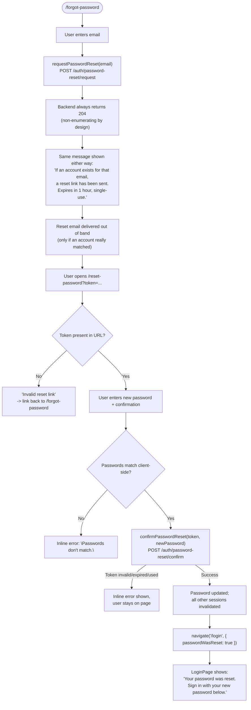

# User Flow Diagrams

**Document:** User_Flow_Diagrams.md

**Status:** Active

**Date:** 2026-10-10

---

## 1. Purpose

This document renders the core ScholarOS user flows as Mermaid flowcharts, grounded directly in the shipped frontend (`frontend/src/App.tsx`'s route table, `OnboardingPage.tsx`, `ChatDetailPage.tsx`, `DocumentsPage.tsx`, the auth pages, and their corresponding API calls) rather than in the product's original conceptual design.

[`docs/srs/08_User_Workflows.md`](srs/08_User_Workflows.md) remains the implementation-agnostic requirements description of user workflows, but it predates a major product pivot: the formal Draft → Review → Decision pipeline it assumes was removed and replaced by a conversational chat/memory model (see [ADR-012](adr/ADR-012_Chat_Memory_Model_Replaces_Draft_Review_Pipeline.md)). Section 6 below lists where the diagrams in this document diverge from `08`'s stage-based description. Per [`09_Documentation_Standards.md`](governance/09_Documentation_Standards.md), this document does not restate requirement rationale already covered in `08` — it shows how those requirements are actually realized in the running application today.

---

## 2. Registration, Login, Google Sign-In, and Email Verification

A user reaches the app unauthenticated at `/`, `/login`, or `/register` (`App.tsx`). Registration accepts either a Google credential or an email/password pair (`RegisterPage.tsx`); login accepts a Google credential or a username/password pair (`LoginPage.tsx`). Both paths call `setToken()` on success, which is what `ProtectedRoute` checks before allowing any authenticated route. Email verification is not a login gate — it gates specific actions (document upload, chat) later in the session, surfaced via `EmailVerificationNotice` when the backend returns an `EmailNotVerifiedError`.

```mermaid
flowchart TD
    Start([User visits "/"]) --> Choice{Has an account?}
    Choice -->|No| Register["/register"]
    Choice -->|Yes| Login["/login"]

    Register --> RegMethod{Sign-up method}
    RegMethod -->|Google button| GoogleScript["Google Identity script loads,\nrenders Sign-In button"]
    GoogleScript --> GoogleCred["User completes Google flow,\nbrowser receives a Google ID token"]
    GoogleCred --> PostGoogle["POST /auth/google { id_token }"]
    RegMethod -->|Email + password form| PostRegister["POST /auth/register { email, password }\n(username derived server-side)"]

    Login --> LoginMethod{Sign-in method}
    LoginMethod -->|Google button| GoogleScript2["Google Identity script loads,\nrenders Sign-In button"] --> GoogleCred2["User completes Google flow"] --> PostGoogle2["POST /auth/google { id_token }"]
    LoginMethod -->|Username + password form| PostLogin["POST /auth/login { username, password }"]

    PostGoogle --> Token["access_token returned"]
    PostGoogle2 --> Token
    PostRegister --> Token
    PostLogin --> Token

    Token --> SetToken["setToken(access_token) - AuthContext\n(ProtectedRoute now treats session as authenticated)"]
    SetToken --> WorkspaceCheck["ProtectedRoute -> WorkspaceGate\nGET workspace"]
    WorkspaceCheck -->|No workspace yet| Onboarding["Redirect to /onboarding"]
    WorkspaceCheck -->|Workspace exists| ChatHome["/chat"]

    SetToken -.-> VerifyState{Account email verified?}
    VerifyState -->|Google sign-in, or grandfathered account| Verified["Verified - no restriction"]
    VerifyState -->|New email/password account| Unverified["Unverified - can browse,\nbut upload/chat actions are blocked"]
    Unverified --> Action["User attempts to upload a document\nor send a chat message"]
    Action --> ApiReject["Backend returns EmailNotVerifiedError"]
    ApiReject --> Notice["EmailVerificationNotice shown\n(\"Resend verification email\")"]
    Notice --> ResendReq["POST /auth/email-verification/request"]
    ResendReq --> EmailSent["Verification email sent out of band"]
    EmailSent --> VerifyLink["User opens link: /verify-email?token=..."]
    VerifyLink --> ConfirmCall["POST /auth/email-verification/confirm { token }"]
    ConfirmCall -->|Success| VerifiedDone["Account marked verified\n'Continue to ScholarOS' -> /chat"]
    ConfirmCall -->|Failure| VerifyFail["Error shown; link to /login\nto request a fresh one"]
```

---

## 3. Onboarding, First Chat Message, and Asynchronous AI Reply

`/onboarding` (`OnboardingPage.tsx`) is a two-visible-step wizard — **Project** then **Documents** — followed by a non-interactive **Generating** state. Both research documents and writing-style samples are genuinely optional; "Generate" (or "Skip and generate" if nothing was uploaded) always advances. The first message a user sends is asynchronous end to end: `sendChatMessage` returns a `work_item_id` immediately, and `ChatDetailPage` polls `getChatReplyStatus` every 1.5 seconds until the reply resolves, persisting the in-flight `work_item_id` to `sessionStorage` so a reload or navigation does not strand the UI.

```mermaid
flowchart TD
    OnboardStart(["/onboarding (ProtectedRoute)"]) --> ProjectStep["Step 1: Project\nTitle, topic, optional description"]
    ProjectStep --> CreateWs["createAgentWorkspace()\n(POST creates one Agent + its one Project)"]
    CreateWs --> DocStep["Step 2: Documents (optional)"]

    DocStep --> UploadResearch{Upload research docs?}
    UploadResearch -->|Yes| ResearchUp["uploadResearchDocuments(projectId, files)"]
    UploadResearch -->|Skip| StyleCheck
    ResearchUp --> StyleCheck{Upload writing-style sample?}
    StyleCheck -->|Yes| StyleUp["uploadWritingStyleDocument(file)"]
    StyleCheck -->|Skip| GenerateClick
    StyleUp --> GenerateClick(["User clicks Generate /\nSkip and generate"])

    GenerateClick --> ExtractCheck{Any style docs uploaded?}
    ExtractCheck -->|Yes| ExtractStyle["extractWritingStyleProfile(documentIds)\n(AI call - derives Writing Profile)"]
    ExtractCheck -->|No| StartConv
    ExtractStyle --> StartConv["startConversation()\n(creates a Conversation)"]
    StartConv --> NavigateChat["navigate(/chat/:conversationId)"]

    NavigateChat --> ChatDetail(["ChatDetailPage"])
    ChatDetail --> LoadMsgs["listConversationMessages()\n(paginated, newest page first)"]
    LoadMsgs --> UserTypes["User types a message, presses Enter"]
    UserTypes --> SendMsg["sendChatMessage(conversationId, content, segmentId?)"]
    SendMsg --> WorkItemReturned["Response returns immediately:\n{ work_item_id } - message is persisted,\nreply generation is only enqueued"]
    WorkItemReturned --> TrackReply["trackActiveReply(work_item_id)\n(state + sessionStorage)"]
    TrackReply --> ShowThinking["ThinkingIndicator shown"]

    ShowThinking --> Poll["Poll getChatReplyStatus\nevery 1500ms while state in\n{queued, running}"]
    Poll --> StatePoll{Work item state}
    StatePoll -->|queued / running| Poll
    StatePoll -->|succeeded| Invalidate["Invalidate conversation-messages query\n(assistant reply now included)"]
    Invalidate --> ClearActive["trackActiveReply(null)"]
    ClearActive --> ShowReply["Assistant reply rendered in thread"]
    StatePoll -->|failed| ShowFailure["Alert: 'Reply failed' + last_error"]
    ShowFailure --> RetryClick["User clicks Retry"]
    RetryClick --> RetryCall["retryChatReply(conversationId, work_item_id)"]
    RetryCall --> Poll
```



---

## 4. Document Upload, Background Processing, and Searchable Knowledge

`DocumentsPage.tsx` uploads are accepted immediately and processed by the backend's Work Item executor in the background — there is no push channel, so the page polls its own document list every 2 seconds while anything remains `pending`/`processing`. A document silently disappears from the "in progress" list into "Processed documents" the moment processing finishes, with a toast confirming the transition so success is never ambiguous. Once processed, a document is only reachable through the knowledge-search box below, which runs the backend's hybrid lexical + semantic retrieval.

```mermaid
flowchart TD
    DocsPage(["/documents (ProtectedRoute + WorkspaceGate)"]) --> SelectFiles["User selects file(s),\noptional title/author/year/DOI"]
    SelectFiles --> UploadCall["uploadResearchDocument(s)()"]
    UploadCall --> Persisted["Document row created,\nprocessing_status = pending\ncontent written to storage,\nWork Item enqueued"]
    Persisted --> ListShows["Document appears in\n'in progress' list"]
    ListShows --> PollLoop["Poll document list every 2000ms\nwhile any doc is pending/processing"]

    Persisted -.-> Executor["Backend Work Item executor\n(separate async process)"]
    Executor --> Extract["Extract text, chunk content"]
    Extract --> Embed["Generate embeddings\n(GoogleGenAIProvider)"]
    Embed --> LexIndex["Index into lexical (FTS5/BM25) store"]
    LexIndex --> DoiCheck{DOI supplied?}
    DoiCheck -->|Yes| DoiVerify["Verify author/year against\npublished record"]
    DoiCheck -->|No| MarkDone
    DoiVerify --> MarkDone["processing_status = processed"]
    Extract -->|Failure at any stage| MarkFailed["processing_status = failed\nerror_message recorded"]

    PollLoop --> StatusCheck{Status transition observed?}
    StatusCheck -->|-> processed| Toast["Toast: '\"Title\" finished processing.'"]
    Toast --> MovesList["Document moves out of in-progress list\ninto 'Processed documents'"]
    MovesList --> Searchable["Now reachable only via\n'Search Processed Knowledge'"]
    Searchable --> SearchCall["searchKnowledge(query)\n(hybrid lexical + semantic, RRF-fused)"]

    StatusCheck -->|-> failed| ShowFailed["Badge: failed, with error_message\n+ Retry / Delete buttons"]
    ShowFailed --> RetryDoc["retryResearchDocument(documentId)\n(re-enqueues Work Item)"]
    RetryDoc --> Persisted
    StatusCheck -->|still pending/processing| PollLoop
```

---

## 5. Password Reset

`ForgotPasswordPage.tsx` deliberately shows the same confirmation message whether or not the submitted email matches a real account — the request endpoint always returns `204`, by design, so the flow can never be used to enumerate which emails have accounts. `ResetPasswordPage.tsx` reads its token from the `?token=` query parameter and redirects the user back to `/login` with a one-time `passwordWasReset` flag that `LoginPage.tsx` reads to show a confirmation banner.



---

## 6. Divergence from the Original SRS Description

[`08_User_Workflows.md`](srs/08_User_Workflows.md) describes a nine-stage, implementation-agnostic workflow (Project Initiation → Material Acquisition → Knowledge Building → Author Profile → Project Memory → Context Assembly → Draft Generation → Draft Review and Refinement → Project Continuity) built around a formal Draft/Draft Version/Review/Review Decision pipeline (WR-019 through WR-025). The real, shipped application differs in ways traceable directly to [ADR-012](adr/ADR-012_Chat_Memory_Model_Replaces_Draft_Review_Pipeline.md):

- **Stages 6–8 (Context Assembly, Draft Generation, Draft Review) no longer exist as distinct user-facing steps.** There is no "request a draft for this section," no explicit accept/reject/revise decision, and no separate review action. All of it collapses into sending a chat message and reading the reply (Section 3 above) — context assembly and evidence grounding still happen, but internally, on every message, not as a user-visible stage.
- **Stage 5 (Project Memory Building) is not a user-driven workflow stage.** `Memory Record` is populated by automatic extraction from conversation content; the user does not explicitly "document research objectives" as a separate activity the way WR-013 describes, though `/memory` does let a user review what was extracted.
- **Stage 4 (Author Profile Establishment) is folded into onboarding's optional "Documents" step**, not a standalone later-stage activity — a user uploads writing-style samples once, up front (or later from `/settings`/`/style-profile`), rather than as a distinct workflow stage entered independently.
- **Generation is asynchronous and polling-based, not synchronous.** WR-019–WR-021's "request draft generation... system generates draft content... user reviews" reads as a single synchronous exchange; the real implementation enqueues a Work Item and the frontend polls for completion (Section 3), including an explicit failed/retry state the SRS does not describe.
- **"Draft" and "Review" as nouns are gone.** Every reference to a reviewable, versioned Draft artifact in `08` reflects the pre-pivot product; the real unit of work is a `Message` inside a `Conversation`.

---

## 7. References

- [`docs/srs/08_User_Workflows.md`](srs/08_User_Workflows.md) — the implementation-agnostic requirements baseline these diagrams implement, with the divergences noted in Section 6.
- [`docs/adr/ADR-012_Chat_Memory_Model_Replaces_Draft_Review_Pipeline.md`](adr/ADR-012_Chat_Memory_Model_Replaces_Draft_Review_Pipeline.md) — the decision record for the pivot described in Section 6.
- [`docs/Project_Status.md`](Project_Status.md) — current implementation status of every flow diagrammed here.
- `frontend/src/App.tsx` — the authoritative route table.
- `frontend/src/pages/OnboardingPage.tsx`, `ChatDetailPage.tsx`, `DocumentsPage.tsx`, `LoginPage.tsx`, `RegisterPage.tsx`, `ForgotPasswordPage.tsx`, `ResetPasswordPage.tsx`, `VerifyEmailPage.tsx` — the source of every step shown above.
- `frontend/src/components/ProtectedRoute.tsx`, `WorkspaceGate.tsx` — the routing gates referenced in Sections 2–4.
